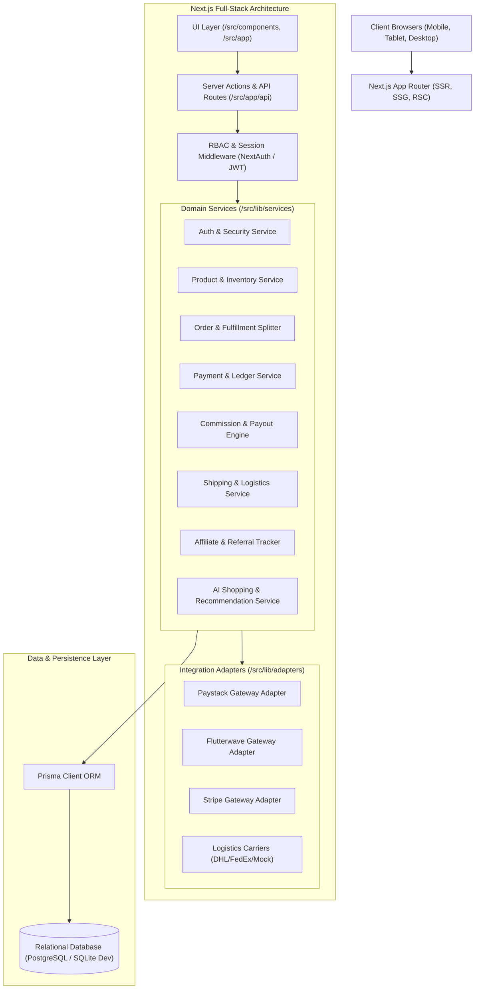

# NUBIMART — SYSTEM ARCHITECTURE
**Architecture Style:** Modular Monolith (Next.js App Router Full-Stack)  
**Language:** TypeScript (Strict)  
**Data Layer:** Prisma ORM with relational schema  
**Styling & UI:** Tailwind CSS with headless accessible primitives and Lucide icons

---

## 1. High-Level Architecture Diagram



---

## 2. Directory Structure Conventions

```
nubimart/
├── prisma/
│   ├── schema.prisma             # Full relational database schema
│   ├── seed.ts                   # Comprehensive marketplace seed data
│   └── migrations/               # Database migration history
├── public/                       # Static public assets (logos, placeholder graphics)
├── src/
│   ├── app/                      # Next.js App Router
│   │   ├── (auth)/               # Auth routes (login, register, forgot-password)
│   │   ├── (public)/             # Public pages (23 corporate/marketplace routes)
│   │   │   ├── shop/             # Catalog browsing, filtering, search
│   │   │   ├── product/[slug]/   # Product detail page
│   │   │   ├── categories/       # Category hierarchy
│   │   │   ├── cart/             # Shopping cart
│   │   │   ├── checkout/         # Multi-vendor split checkout
│   │   │   ├── about/            # About Us
│   │   │   ├── our-story/        # Our Story
│   │   │   ├── why-nubimart/     # Why NUBIMART
│   │   │   ├── how-it-works/     # How it works
│   │   │   ├── global-shopping/  # Global shopping & 38 countries
│   │   │   ├── become-seller/    # Seller registration landing
│   │   │   ├── affiliate/        # Affiliate program
│   │   │   ├── logistics/        # Logistics partners
│   │   │   ├── payments/         # Payment partners
│   │   │   ├── warehouses/       # Warehouse network
│   │   │   ├── investors/        # Investor relations
│   │   │   ├── careers/          # Careers & openings
│   │   │   ├── blog/             # Marketplace insights blog
│   │   │   ├── news/             # Press releases & news
│   │   │   ├── contact/          # Contact us
│   │   │   ├── faq/              # Frequently asked questions
│   │   │   ├── privacy/          # Privacy policy
│   │   │   └── terms/            # Terms of service
│   │   ├── account/              # Customer portal (Orders, Wishlist, Addresses, Settings)
│   │   ├── seller/               # Seller portal (Products, Orders, Inventory, Wallet, Store)
│   │   ├── admin/                # Administrator control plane (Moderation, KYC, Analytics)
│   │   └── api/                  # RESTful API handlers and Webhooks
│   │       ├── auth/             # Session, registration, login endpoints
│   │       ├── products/         # Product catalog, search, recommendations
│   │       ├── cart/             # Cart persistence & verification
│   │       ├── checkout/         # Order creation & total calculation
│   │       ├── webhooks/         # Payment gateways webhook receivers
│   │       ├── seller/           # Seller management & onboarding
│   │       └── admin/            # Moderation & administrative actions
│   ├── components/               # Modular reusable UI components
│   │   ├── ui/                   # Design system primitives (Button, Modal, Input, Badge, etc.)
│   │   ├── layout/               # Global Header, Footer, AnnouncementBar, Sidebar
│   │   ├── product/              # ProductCard, Gallery, VariantPicker, ReviewCard
│   │   ├── cart/                 # CartDrawer, CartSummary, CheckoutFlow
│   │   ├── seller/               # SellerMetricCard, ProductForm, OrderTable
│   │   └── admin/                # AdminStatsCard, SellerKYCModal, ModerationQueue
│   ├── context/                  # Client contexts (CurrencyContext, CartContext, AuthContext)
│   ├── lib/                      # Core business logic and helpers
│   │   ├── auth/                 # JWT tokens, password hashing, RBAC guards
│   │   ├── db/                   # Prisma client singleton
│   │   ├── services/             # Domain business logic (Order, Product, Commission, etc.)
│   │   ├── adapters/             # External integration adapters (Paystack, Logistics, AI)
│   │   ├── constants/            # Supported countries, currencies, category definitions
│   │   ├── utils/                # Currency formatters, slug generators, date formatters
│   │   └── validation/           # Zod schemas for forms and API requests
│   └── types/                    # Shared TypeScript interfaces & types
├── .env.example                  # Environment configuration template
├── package.json                  # Dependencies and execution scripts
├── tailwind.config.ts            # Tailwind CSS styling tokens
└── tsconfig.json                 # TypeScript strict compiler options
```

---

## 3. Security, Permissions & RBAC
Three core roles are supported:
- **`CUSTOMER`:** Standard buyer account. Can browse products, manage personal cart, place orders, write reviews for purchased items, maintain personal addresses, and participate in affiliate referral.
- **`SELLER`:** Merchant account. Can configure storefront, create/edit products (subject to admin approval), manage store-specific inventory, fulfill assigned sub-orders, and request payouts. Restricted from modifying other merchants' data.
- **`ADMIN`:** Platform superuser. Can inspect system metrics, review and approve/reject seller KYC applications, approve/reject product catalog entries, configure platform commissions, and inspect audit logs.

All API routes and server actions validate permissions on the server using authenticated user session tokens.

---

## 4. Multi-Vendor Order Splitting Architecture
When a customer purchases items from multiple distinct vendors in a single checkout session:
1. Server verifies real-time stock and calculates verified prices for all items.
2. An overarching **`Order`** is created representing the buyer's checkout transaction.
3. The server automatically groups items by `sellerId` and creates separate **`FulfillmentOrder`** records.
4. Each `FulfillmentOrder` tracks its independent fulfillment status:
   `PENDING` → `CONFIRMED` → `PACKED` → `SHIPPED` → `DELIVERED` (or `CANCELLED`).
5. Sellers only see and fulfill the sub-order relevant to their store.
6. The buyer's account displays the overarching order along with itemized progress for each vendor's delivery.
