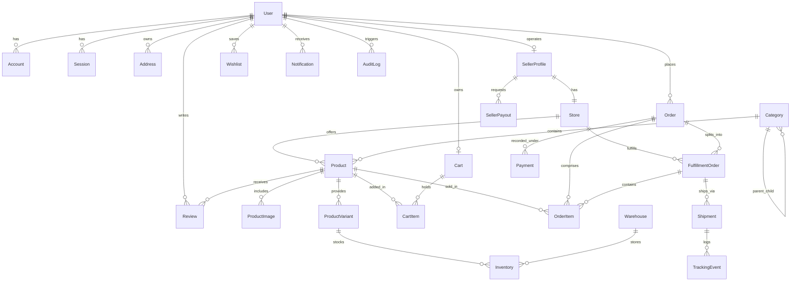

# NUBIMART — DATABASE SCHEMA DOCUMENTATION
**ORM:** Prisma ORM  
**Target Engines:** PostgreSQL (Production) / SQLite (Zero-config local development & verification)  
**Precision Standard:** Decimal monetary values, ISO-8601 timestamps, UUID / CUID unique identifiers

---

## 1. Entity-Relationship Overview

---

## 2. Core Entities & Field Specifications

### User & Authentication
- **`User`**: `id`, `name`, `email`, `passwordHash`, `role` (`CUSTOMER`, `SELLER`, `ADMIN`), `avatar`, `phoneNumber`, `emailVerified`, `status` (`ACTIVE`, `SUSPENDED`), `createdAt`, `updatedAt`.
- **`Address`**: `id`, `userId`, `fullName`, `phone`, `street`, `apartment`, `city`, `state`, `postalCode`, `countryCode` (ISO-3166 2-letter), `isDefaultShipping`, `isDefaultBilling`.

### Seller & Storefront Management
- **`SellerProfile`**: `id`, `userId`, `businessName`, `businessType`, `regNumber`, `taxId`, `countryCode`, `verificationStatus` (`DRAFT`, `SUBMITTED`, `VERIFIED`, `REJECTED`, `SUSPENDED`), `rejectionReason`, `idDocumentUrl`, `proofOfAddressUrl`, `bankName`, `bankAccountNumber`, `bankAccountName`, `walletBalance` (Decimal), `pendingBalance` (Decimal).
- **`Store`**: `id`, `sellerProfileId`, `name`, `slug` (unique), `description`, `logoUrl`, `bannerUrl`, `supportEmail`, `supportPhone`, `rating` (Float), `reviewCount` (Int), `isActive` (Boolean).

### Catalog, Categories & Inventory
- **`Category`**: `id`, `name`, `slug` (unique), `description`, `imageUrl`, `icon`, `parentId`, `featured` (Boolean).
- **`Product`**: `id`, `storeId`, `categoryId`, `name`, `slug` (unique), `description`, `summary`, `brand`, `basePrice` (Decimal), `salePrice` (Decimal, nullable), `sku` (unique), `status` (`DRAFT`, `PENDING_APPROVAL`, `APPROVED`, `REJECTED`, `ARCHIVED`), `featured` (Boolean), `viewCount` (Int), `rating` (Float), `reviewCount` (Int), `createdAt`, `updatedAt`.
- **`ProductImage`**: `id`, `productId`, `url`, `altText`, `sortOrder`, `isPrimary` (Boolean).
- **`ProductVariant`**: `id`, `productId`, `sku` (unique), `name` (e.g., "XL / Navy"), `attributesJson` (e.g. `{"size":"XL","color":"Navy"}`), `priceAdjustment` (Decimal), `stockQuantity` (Int).
- **`Warehouse`**: `id`, `name`, `code`, `countryCode`, `city`, `address`.
- **`Inventory`**: `id`, `productId`, `variantId` (nullable), `warehouseId`, `quantity`, `reservedQuantity`, `lowStockThreshold`.

### Shopping Cart, Orders & Fulfillment
- **`Cart`**: `id`, `userId` (nullable for guest carts), `sessionToken` (nullable), `createdAt`, `updatedAt`.
- **`CartItem`**: `id`, `cartId`, `productId`, `variantId` (nullable), `quantity`, `addedAt`.
- **`Order`**: `id`, `orderNumber` (unique, e.g. `NUB-2026-90412`), `userId`, `subtotal` (Decimal), `discountTotal` (Decimal), `shippingTotal` (Decimal), `taxTotal` (Decimal), `grandTotal` (Decimal), `currencyCode` (e.g., `USD`, `NGN`), `exchangeRateToBase` (Decimal), `status` (`PENDING`, `PAID`, `PROCESSING`, `PARTIALLY_SHIPPED`, `COMPLETED`, `CANCELLED`, `REFUNDED`), `shippingAddressJson`, `billingAddressJson`, `createdAt`.
- **`FulfillmentOrder`**: `id`, `orderId`, `storeId`, `subtotal` (Decimal), `shippingFee` (Decimal), `commissionRate` (Decimal), `commissionAmount` (Decimal), `sellerEarnings` (Decimal), `fulfillmentStatus` (`PENDING`, `CONFIRMED`, `PACKING`, `SHIPPED`, `DELIVERED`, `CANCELLED`), `shippingMethod`, `createdAt`.
- **`OrderItem`**: `id`, `orderId`, `fulfillmentOrderId`, `productId`, `variantId` (nullable), `productName`, `sku`, `unitPrice` (Decimal), `quantity` (Int), `totalPrice` (Decimal).

### Payments, Financials & Logistics
- **`Payment`**: `id`, `orderId`, `paymentMethod` (`PAYSTACK`, `FLUTTERWAVE`, `STRIPE`, `MONNIFY`, `PAYPAL`, `TEST_GATEWAY`), `providerReference` (unique), `amount` (Decimal), `currencyCode`, `status` (`PENDING`, `SUCCESSFUL`, `FAILED`, `REFUNDED`), `rawResponseJson`, `paidAt`.
- **`SellerPayout`**: `id`, `sellerProfileId`, `amount` (Decimal), `currencyCode`, `status` (`REQUESTED`, `PROCESSING`, `COMPLETED`, `REJECTED`), `bankDetailsJson`, `requestedAt`, `processedAt`.
- **`Shipment`**: `id`, `fulfillmentOrderId`, `carrier` (e.g., `DHL`, `FEDEX`, `LOCAL_COURIER`), `trackingNumber`, `shippingLabelUrl`, `status` (`MANIFESTED`, `IN_TRANSIT`, `OUT_FOR_DELIVERY`, `DELIVERED`), `estimatedDelivery`.
- **`TrackingEvent`**: `id`, `shipmentId`, `status`, `location`, `description`, `timestamp`.

### Customer Engagement & Governance
- **`Review`**: `id`, `userId`, `productId`, `orderId` (verified purchase link), `rating` (1-5), `title`, `comment`, `verifiedPurchase` (Boolean), `createdAt`.
- **`Wishlist`**: `id`, `userId`, `productId`, `createdAt`.
- **`Coupon`**: `id`, `code` (unique), `discountType` (`PERCENTAGE`, `FIXED`), `discountValue` (Decimal), `minOrderAmount` (Decimal), `validFrom`, `validUntil`, `usageLimit`, `usedCount`, `isActive`.
- **`Affiliate`**: `id`, `userId`, `referralCode` (unique), `commissionRate` (Decimal), `totalEarnings` (Decimal), `paidEarnings` (Decimal).
- **`Notification`**: `id`, `userId`, `title`, `message`, `type` (`ORDER`, `SELLER`, `PROMO`, `SECURITY`), `isRead` (Boolean), `actionUrl`, `createdAt`.
- **`AuditLog`**: `id`, `userId` (nullable), `action`, `resource`, `resourceId`, `detailsJson`, `ipAddress`, `createdAt`.
